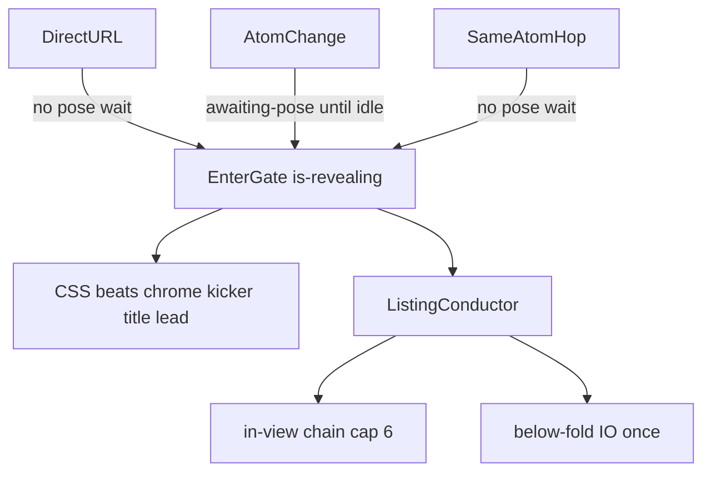

# Page entrance motion

Source of truth for how HTML/UI appears on off-home routes. Persistent molecular HUD (logo, grid, ticks, rail) is **not** replayed here — it already hides on `.is-approaching` and returns with the pose. Home (`/`) has no page overlay choreography; a direct load of `/` instead runs the [home boot](#home-boot-direct-load) below.

**Hairline draw** on enter is the motion layer of the site-wide hairline language — static rules and tokens are defined in [`DESIGN.md` § Hairline language](DESIGN.md#hairline-language). Same `--wl-line`, same left → right wipe, same line-before-content cadence everywhere listings appear.

Tokens live on `:root` in [`app/assets/css/main.css`](../app/assets/css/main.css). Archive listing CSS: [`archive.css`](../app/assets/css/archive.css). Case first-viewport CSS: [`case.css`](../app/assets/css/case.css). Gate: [`usePageContentReveal`](../app/composables/usePageContentReveal.ts). Listing split: [`useListingReveal`](../app/composables/useListingReveal.ts).

## Home boot (direct load)

Direct load of home assembles the molecule instead of cutting to a finished scene. Code:
[`HeroIntro`](../app/lib/hero/HeroIntro.ts), wired in [`mountHeroApp`](../app/lib/hero/mountHeroApp.ts). In-app returns to home (atom → home, logo click) keep the existing return animation — the boot is created only when `spatialFromRoute(pathname).mode === 'home'`.

One GSAP clock drives both layers: Three.js values are read from a mutable `MoleculeIntroReveal` object every frame, and the CSS side only reacts to phase classes on `.molecular-chrome` (`is-boot` → `is-boot-ui`). No second timeline in CSS, so the canvas and the chrome cannot drift.

| Beat (desktop, ms from first rendered frame) | Layer | What happens |
|------|-------|--------------|
| 0 | chrome | `is-boot`: header, rail, USP, connector, progress, HUD frame + meta hidden; grid dimmed to `0.45` |
| 60 | molecule | hub shell condenses (`mesh.scale` 0.32 → 1, `back.out` landing) |
| 420 + 70/ring | molecule | each orbit fades in edge-on and tumbles into its plane (`DecorativeNodes.setOrbitUnfold`: shortest arc + one full turn); neighbouring starts overlap, so the rings read as one gyroscope spinning up |
| 700 → 2150 | dust | the ambient shell is born at the hub centre and spirals out — the hub dive mirrored — each point on its own delay, decelerating into its resting radius (`ParticleMist` `uBoot`) |
| 1160, legs of 320 | comet | one comet runs the orbits in `PERIPHERAL_ATOM_IDS` order: head from `θ+π` to the atom's `θ`. The connector is drawn 300 ms ahead, and the atom lands exactly as the head arrives (`scale 0.32 → 1`); then the arc jumps to the next ring. Last atom lands at 2440 |
| 1850 | text | atom labels + tag cloud appear together (`text` gate); a label still waits for its own atom |
| 2200 | atmosphere | drafting field + atom rims fade in (`introReveal`) |
| 2500 | molecule | horizontal entity light sweep (same light language as cases, no frozen route needed) |
| 2820 → 3380 | framing | the desktop stage bias waits for the finished molecule: a short push of `screenX 0.5 → 0.62`, `screenY 0.5 → 0.45`, `approach −0.85 → 0` (`setCompositionFramingOverride`); extra boot yaw returns to 0 over the same 560 ms |
| 1500 | chrome | `is-boot-ui`: HUD frame + header fade, rail items stagger by `--reveal-i`, grid returns to full |
| 3440 | both | hand-off: `is-boot*` removed, committed reticle / connector / USP return, autoplay starts |

- Tablet / mobile: no lateral drift (starts and ends on the profile framing, `0.50 → 0.56` y at most), whole clock × `0.86`.
- Skip: first `pointerdown` / `keydown` fast-forwards the timeline (`timeScale(6)`) instead of snapping, so phases stay ordered. Atom hover / click are gated while the boot is active.
- Guard: if no frame is rendered within 1.6s (WebGL failure), the boot finishes immediately so the HUD is never hostage to the canvas.
- `prefers-reduced-motion: reduce`: no boot at all — `is-boot` is never added.
- Leaving home mid-boot (`applyHudMode(false)`) finishes it first: an approach must never run with hidden atoms.

## Two entries, one sequence

| Entry | Pose wait | When HTML starts |
|-------|-----------|------------------|
| Direct URL / refresh | No (`fromMatched === 0` in [`poseReveal`](../app/lib/navigation/poseReveal.ts)) | `onMounted` — do **not** hide content while the canvas is still `ClientOnly` |
| Atom change (home approach or off-home retarget) | `.app-shell.is-awaiting-pose` until Navigator idle | Same beats, no extra hold (user already watched the molecule) |
| Same atom (`/portfolio` ↔ case, `/services` ↔ slug) | No | Archive uses this system; case body stays on [`useCasePageTransition`](../app/composables/useCasePageTransition.ts) + ScrollTrigger |

`.is-revealing` on the page shell is the **EnterGate**. Choreography is identical after the gate opens.

## Beats (t = 0 at gate)

Do not fade the whole `.archive-page__body` — chrome sits outside the body and must enter on its own.

| Beat | Target | Delay | Motion |
|------|--------|-------|--------|
| 0 chrome | `SiteChrome` (`.case-chrome__header--meta`) | `--enter-beat-chrome` (0) | opacity |
| 1 kicker | `.archive-heading__kicker` (section INDEX only; detail entity/index is SiteChrome-only) | `--enter-beat-kicker` (40ms) | opacity |
| 2 title | `SiteScrambleTitle` | `--enter-beat-title` (80ms) conceptually | existing scramble, pose-gated — **no extra CSS fade** |
| 3 lead | intro, tags, section titles, case intro/facts, `.editorial-hero-media__fill` (after frame draw) | `--enter-beat-lead` (140ms) for copy; fill delay = `--line-draw-duration` + overlap |
| 4 list | `.archive-row` | `--enter-beat-list` (180ms) + stagger | hairline `scaleX`, then row content |
| 5 tail | `[data-enter="tail"]` (pagination, about CTA, archive `DetailNav`, case `CaseThanks`) | same split as list | opacity + `--enter-y` |

Case pages share the same listing conductor as archives (numbered sections + NEXT footer rows). Hero beats 0–3 stay separate; gallery / slices / mobile mockup keep ScrollTrigger L2/L3. GSAP remains allowed **only** for case ScrollTrigger L2/L3, case→case, `Navigator`, and pointer lerp (`gsap.quickTo` on nested tilt — landing / device / slice focus; not on the ScrollTrigger node).

Pointer / gyro ([`useCaseInteractive`](../app/composables/useCaseInteractive.ts)) starts only after pose settle + body `idle`, pauses while the lightbox is open, and unbinds off-screen. **Do not crop** landing or repeater screens; the only cut media is mobile slices.

## Listing split (chain vs viewport)

Do **not** assign `animation-delay: index * n` to every row. A below-fold item would sit idle for hundreds of ms after it enters view.

After gate + archive-return restore + two rAFs:

1. Collect `.archive-list .archive-row`, `[data-enter="tail"]` (except `.case-nav`, handled below), on case pages `.case-section:not(.case-nav)` + `nav.case-nav.case-section`, CMS prose blocks (`p`, headings, bare content `div`s without nested lists) and list rows in case prose/caption, and on archive pages `nav.case-nav.case-section` (service detail) + `nav.case-nav--archive`.
2. In-view = intersects the viewport with an ~8% bottom inset.
3. In-view items in DOM order: `data-reveal="chain"`, `--reveal-i: min(i, cap-1)`. Cap **6**, stagger `--enter-stagger` (55ms).
4. Below-fold: one `IntersectionObserver` (`rootMargin: 0px 0px -8% 0px`), `once`. On intersect: `data-reveal="in"`, delay **0**.
5. Played → `data-reveal="done"`. Never replay.

Uprock motif — implementation of [hairline language](DESIGN.md#hairline-language): the **full-width** row hairline (`::before` / last-row `::after`), wiped **left → right** via `clip-path: inset(0 100% 0 0)` → `inset(0 0 0 0)`. Short `.archive-row__line` tick uses `scaleX(0 → 1)` with `transform-origin: left`. Row content starts after `--reveal-content-delay` so the draw reads first. **Hairline hosts stay opaque** — fade only content (`.archive-row__link`, `.case-marker > *`, list `li > *`); never put `opacity` animation on the element that owns the line pseudo. Case CMS lists normalize mixed `li` markup via [`wrapCaseListItemBodies`](../app/domain/wp/htmlPlain.ts) so `li > *` is a single fade unit (text nodes + `strong`).

Same motif on case section markers, CMS list rows, and footer nav. **Footer nav** (`nav.case-nav`) is one listing unit; when `is-revealed`, an internal chain runs via `--nav-origin` + step offsets: case / service detail (`case-section`) — marker line → marker label → Next → Previous line → Previous → Index; archive-only (`case-nav--archive`) — Next → Previous line → Previous → Index.

Layout **social footer** (`SiteFooterMenu`) is outside the page shell: pose-gated (`is-awaiting-pose`) fade-up with `--enter-beat-list`, hidden on `/contact`. **Legal footer** (`SiteFooterLegal`) uses the same pattern. Cookie HTML is phrasing-safe (`unwrapOuterParagraph` + `div` host) so SSR does not nest `
` — see [`CONTENT.md`](CONTENT.md) gotchas.

**About CTA** (`.about-cta`): pose-gated `wl-enter-fade-up` in [`about.css`](../app/assets/css/about.css), with chain/IO reveal index. Fallback for late WP data arrival (`v-if="page.ctaLabel"` may render after initial `classify()`).

**Site header** (`.site-header`): entrance `wl-enter-fade` gated on `.molecular-chrome.is-settled-route` — the whole header row (logo + locale + routes + node) fades in together. During `.is-approaching` the header is hidden (`opacity: 0`).

`archive-row--detail:last-child` has no bottom hairline (unchanged).

### Archive return and pagination

- [`archiveReturn`](../app/lib/navigation/archiveReturn.ts) restore jumps instantly, then measure. Chain only rows actually in view after the jump — not from page index 0 at scroll 0.
- Page change: [`useArchivePaginationScroll`](../app/composables/useArchivePaginationScroll.ts) gates listing measure (`beginArchivePagination` / `endArchivePagination`); scroll runs after `nextTick` so stale rows are not visible at scroll 0. [`usePortfolio`](../app/composables/usePortfolio.ts) / [`useServices`](../app/composables/useServices.ts) track `dataPage` — entries from `useAsyncData` are shown only when they match the current `?page=`; during fetch the list and pagination are empty (`transitioning`), then new rows mount and the conductor classifies **new** nodes only.
- Empty / pending list: no-op.
- `prefers-reduced-motion`: everything visible, no IO, no delays.

## Tokens

Line tokens are part of the global design language ([`DESIGN.md` § Hairline language](DESIGN.md#hairline-language)). Motion-only tokens below.

| Token | Value | Use |
|-------|--------|-----|
| `--enter-stagger` | `55ms` | In-view chain step |
| `--enter-duration` | `0.55s` | Fade / fade-up |
| `--enter-ease` | `cubic-bezier(0.22, 1, 0.36, 1)` | Shared ease |
| `--enter-y` | `10px` | Lead / row / tail lift |
| `--enter-beat-chrome` … `--enter-beat-list` | `0 / 40ms / 80ms / 140ms / 180ms` | Beat clock |
| `--line-draw-duration` | `1.25s` | Full hairline wipe — shared with static `--wl-line` rules |
| `--line-draw-ease` | `cubic-bezier(0.33, 0, 0.18, 1)` | Draw easing |
| `--reveal-cap` | `6` | Max distinct chain delays |
| `--reveal-content-delay` | `500ms` | Line → content overlap (~40% into draw) |

## Performance

- Full hairlines: `clip-path` wipe left → right. Short ticks: `scaleX` + `transform-origin: left`. No `width` / `border` animation.
- One IntersectionObserver per `ArchiveShell`, not ScrollTrigger, not GSAP on listings.
- Do not animate off-screen rows.
- Cap the chain; do not sequence 12 acts.
- `will-change` only while an item is playing; clear on `animationend`.
- Specimen enter = opacity + small translate — no filters, no scale.
- Hover `width` on `.archive-row__line` must not run during enter (gated on `.is-revealed`).

## Scene field (WebGL)

The home molecule's motion is **data**: dust points drift on a shell and stream along the bond
toward the upcoming atom (hover / autoplay-next), and the orbit comet rides that same upcoming
atom — the committed orbit reads edge-on after the approach pose. The frozen atom's drafting field
is **not** HTML and **not** ScrollTrigger. Both live in
[`MoleculeEffects`](../app/lib/molecular/effects/MoleculeEffects.ts) and follow the listing cadence:
1.25s draw, 55ms per-layer stagger, line-first. A passive scroll listener only writes normalized
progress into the scene; it does not move the page content or the spatial pose. Reduced motion pins
the field static. Details: [`EFFECTS.md`](EFFECTS.md).

## Reduced motion / no-JS

- `prefers-reduced-motion: reduce`: no keyframes; final state immediately.
- Without `.js-enabled`: hairlines at `scaleX(1)`, all content visible (SSR / no-JS).

## What not to animate

- Persistent HUD / molecule / connector (the one exception is the [home boot](#home-boot-direct-load) on a direct load of `/`).
- Title scramble (already gated).
- Case gallery, mobile mockup (lift), slices (L3 scrub) — ScrollTrigger owns inner motion; listing reveal handles section shell + marker line only.
- Navigator / `poseReveal` direct-load semantics.
- Atom drafting field — owned by `MoleculeEffects`, not CSS / ScrollTrigger.
